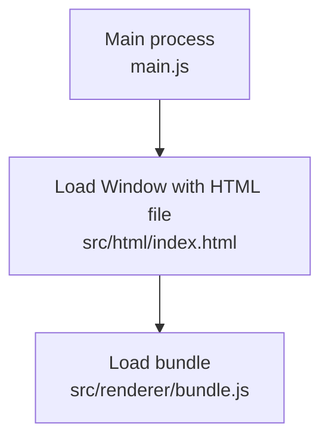

# Simple Electron + d3 template (JavaScript)

Minimal setup for experimenting with visualizations in Electron using d3.

## Project structure

- `src/main` – Electron main process (`main.js`, `preload.js`)
- `src/html` – HTML entry (`index.html`, optional CSS in `style.css`)
- `src/renderer` – Renderer source (`renderer.js`) and bundled file (`bundle.js`)

## Setup

```bash
npm install
```

## Build and run

- **Build renderer + start Electron**:

```bash
npm start
```

This will:
1. Run webpack to bundle `src/renderer/renderer.js` into `src/renderer/bundle.js`.
2. Start Electron using `src/main/main.js`, which loads `src/html/index.html`.
3. The loaded HTML will load `src/renderer/bundle.js`.




## Where to edit

- Change visualizations in `src/renderer/renderer.js`.
- Adjust HTML in `src/html/index.html`.
- Optional styling in `src/html/style.css`.

The generated `src/renderer/bundle.js` is build output – you do not edit it.

## Debugging

Webpack bundles the renderer code and generates a source map (see `webpack.config.js`).  
In Chrome's DevTools you can:

- Open **Developer Tools** → **Sources**
- In the left sidebar, open the source map (not the one starting with `file://`)
- Navigate to `src/renderer/renderer.js`
- Set breakpoints and inspect variables there, even though Electron is executing `bundle.js`.

## Future roadmap

This is intentionally a very simple (and slightly messy) bundling setup.  
For your master thesis project, you are expected to:

- Use a more structured build pipeline with dedicated output folders
- Introduce TypeScript for both main and renderer
- Organize configuration (webpack or other tooling) more cleanly
